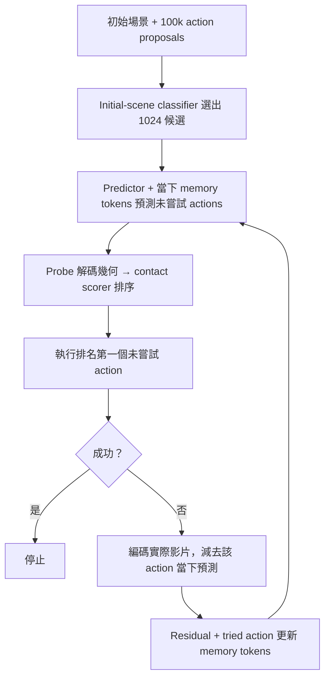

# 組員接手：目前卡在哪裡，下一步怎麼驗證

整理：2026-11-06；證據截至 2026-10-21。閱讀順序：先看本頁的問題、結果與下一步；需要完整時間線或簡報數字時，再看 [實驗流程與 slide 對照](EXPERIMENT_FLOW_AND_SLIDE_ALIGNMENT.md)。

**目前最值得追的問題是：support 的資訊究竟能修正哪些 query？** 我們已看到預測距離軌跡作為排序參照的改善訊號，但尚未證明「實際觀測的 residual」有額外價值。接手的目標是辨認有用的資訊與作用方式，再決定是否值得擴大 memory 訓練。以下方案尚未執行，不是已得到的結論。

## 1. 任務、模型與部署時能取得的資訊

PHYRE 每個場景有一個物理目標，例如讓兩個指定物體接觸。Action 是放下一顆紅球的位置與大小 `(x,y,size)`。嘗試失敗後重設場景，再選另一個 action。Cross 測未見過的 task templates，within 測已見 templates 的新場景。

我們的 pipeline：



最多九次嘗試。不同場景之間 tokens 重設。Base 沒 memory prefix；Q0 有 32 個學到的 initial tokens，但不根據 observation 更新；memory 版本把 tokens 作為 predictor self-attention 的 prefix，並透過 cross-attention updater 修改 tokens。Updater 訓練期間 predictor、initial tokens 與 probe 固定。AdaJEPA-style baseline 改 predictor 的部分權重，與改 tokens 是不同途徑。

Support 是已試過的 action，query 是接下來要評估的候選。當下 residual 是：

`r_support = encoder(observed video) − predictor(scene, support action, current tokens)`

多輪更新改變 tokens 後，不能繼續使用舊 predictor residual。最新單次 feedback 診斷固定 Q0 與共同 first action，因此可以快取第一次 residual；這是特定診斷的條件，不是一般 multi-turn 的近似。

Scorer 使用 probe 預測的目標物體間表面距離，將 32 個時間點的 soft-contact 訊號聚合成排序分數。它不是校準過的成功機率。預測 latent 的平均 L1 變小，不保證這個分數的 action 次序更正確：平均誤差包含大量不影響接觸的維度，而且排序在乎成功／失敗 actions 的相對差異。

## 2. 接手時需要記住的結果

### 多輪 pilot 有改善，但觀測的貢獻尚未分離

現有 slide 的首 seed、100 scenes/panel、多輪 S@9：within Q0 50%、AdaJEPA-style 58%、L1 memory 56%、Smooth L1 + inference centering 61%；cross 分別為 11%、9%、12%、15%。Cross Smooth 的 zero-input control 也有 14%。

後續 within **raw-input** 第二 seed 是 L1 58%、Smooth 50%，首 seed 為 56%、61%。不能把首 seed 的改善當成已穩定複現；第二 seed 也不是 centered 組合的直接測試。[完整表與 protocol](EXPERIMENT_FLOW_AND_SLIDE_ALIGNMENT.md#現有-slide-的數字是否-align)。

### 最新診斷顯示 predicted support context 值得研究

固定 cross fold 1 的 100 scenes、Q0、classifier pool 與 first action。第一個 action 成功 3 scenes，另外 97 scenes 在一次 failure 後重新排序。訓練只有 53 個 failed-first scenes，每場固定 8 queries，共 424 labels，其中 32 positive。Head 使用固定 world model 的特徵，直接修正分數，不修改 latent。

| 模型／額外輸入 | Seed 8419 S@2 | Seed 8420 S@2 |
| --- | ---: | ---: |
| Q0 固定排序 | 5/100 | 5/100 |
| 靜態 learned readout | 6/100 | 6/100 |
| Query-only MLP | 5/100 | 6/100 |
| Full support context，zero residual | 9/100 | 8/100 |
| Full support context，real residual | 8/100 | 8/100 |
| Query 自己的完整距離軌跡 | 6/100 | 8/100 |
| Support 預測距離特徵 + query–support 距離差 | 8/100 | 10/100 |

最後一列在 97 個 first failures 中的下一批 top-5 coverage 是兩 seeds 都 11/97，query 完整距離對照都是 5/97。這個訊號不只出現在 top-1，但目前只有一個 fold、兩 seeds，而且探索過很多條件，尚無穩定贏家。所有條件而非只選最好列，可看 [完整 CSV](../research/results/support_context_ablation_20261021/CROSS100_TABLE.csv)。

這裡 **S@2 = 3 個 first successes + 重新排序的 top-1 successes**。下一批 top-5/8 是一次 ranking 的 coverage，不是每次失敗都重新更新的 S@6/9。Training-template 內的兩組小驗證 panel 也不是官方 within。

Zero residual 仍可看到 support action、support 的預測特徵、query–support 關係，且只在已知 first attempt 失敗的情況使用。因此它不是「完全沒有任何 feedback」。但最新幾何特徵本身全部可在執行前計算；目前沒有讓 success/failure outcome 改變的完整對照，也就不能斷言改善來自失敗訊息。

## 3. Bottleneck：證據到哪裡，還缺什麼

| 可能卡點 | 已有證據 | 尚不能推論的事／下一個判別 |
| --- | --- | --- |
| **Prediction 到 decision 的資訊損失** | 同 probe/scorer 換真實影片 latent，小 oracle panel 的 S@9 從 Q0 cross 20% 到 100%、within 60% 到 96%。 | Oracle panel 只有 10/25 scenes，且 pools 都有解。它不能區分 predictor 不準與 probe 對 predicted latent 的失配，也不保證平均 latent L1 是好訓練目標。 |
| **Support 的修正是否適用其他 queries** | 最新 predicted support + relative distance 有改善；action-only 未重現完整改善。正確 support 優於打亂 support 的訊號在部分指標出現。 | 可能只是同場景的參照尺度。打亂結果不一致，尚無因果歸因；優先比較 selected support 與不需 trial 的 scene reference。 |
| **觀測 residual 的表示或使用方式** | Real head 沒穩定勝過 zero；centering 在首 seed 有幫助。 | 可能有 nuisance、壓縮丟失任務訊號，或一條 support 根本不足。Head 的 residual 經池化與 16 維投影；不能將它的負結果推廣成所有 observation representations 都沒用。 |
| **訓練 supervision 與泛化** | 最新 head 只有 424 queries、32 positives；多 seed/validation 的結果變動大。 | 「資料不夠」合理但未被隔離驗證。重複同 424 樣本更多 steps 不等於增加資料；多 queries 也不等於多 scenes/templates。 |
| **Loss、probe 與更新穩定性** | BCE、pairwise、contact target、probe adaptation、縮小 update 都沒有穩定 cross 改善。 | 短程 pilot 不能排除更好設計；但沒有證據支持盲目延長同設定，或把整個問題歸咎於單一 loss。 |
| **Candidate recall 上限** | 原 100k cache coverage：classifier top-1024 cross 61%、within 98%。 | 限制整體上限，但不能解釋同池中 real 為何輸 zero。後續應用同輪 fresh labels 報 actual coverage，分開 selector 與 reranker 的問題。 |

Probe adaptation 的小驗證（32 scenes，31 有定義 AUC）沒有提高平均 ranking，故未做 closed-loop；這只降低「簡單適配 probe 就能解決」的優先度。[來源](../research/results/current_probe_adaptation_20261020/FINAL_SUMMARY.json)

Success-objective round 另發現 frozen BCE score calibration 的可達機率受限，改可學習 calibration 後仍未穩定救回；因此不能由這輪說 BCE 本質上比 pairwise 差。Contact-distance 的 query 真值修正診斷中，只朝真值移動 10% 就可改善小樣本 top-1；那使用了部署不可取得的 query 真值，證明的是「存在有用的修正」，不是「support 能推斷該修正」。[來源](../research/results/success_objective_loop_20261021/FINAL_FINDINGS.json)

此外，一個 confirmation 場景的靜態 head logit 約 1405，cross logits 則正常。它提醒我們檢查 normalization/extrapolation，但不能拿來解釋 cross 失敗。[診斷](../research/results/feedback_readout_loop_20261021/STATIC_LOGIT_RANGE_DIAGNOSTIC.json)

## 4. 建議先跑什麼：三個可以分工的方案

### A. 先區分「support 特有資訊」與「場景參照」——最高優先

**問題：** 最新 zero-residual 幾何組的改善，是需要選中的 support，還是任何合理的同場景參照都能做到？

固定 raw query distance 輸入、head 容量、loss、training queries、two seeds、first action 與 attempted-action mask。所有分支都不看觀測 residual，從同一預測池選 reference：

1. 無 reference：query 完整距離控制。
2. Q0 first action 的預測距離曲線。
3. 同場景 1024 個合法候選的平均預測距離曲線。
4. 固定 seed、與真實成敗無關的隨機候選曲線。

每個 reference 都先形成 32 點曲線，再用**相同函數**產生 reference features 與 query–reference 差。不要一邊用「先抽 features 再平均」、另一邊用「先平均曲線再抽 features」，兩者通常不同。所有 normalization 僅 fit training queries。保留既有 full-zero head 作參照；新增 mask 分支盡量保持相同參數量及初始化。

**判讀：** 若 mean reference 與 selected reference 相近，優先做 scene-conditioned 靜態 ranker；若 selected reference 在兩 seeds 的 paired scenes 與 top-5 都較好，再追查它與 query 的特殊關係。平均曲線不代表真實可執行 trajectory，所以也要看 random reference，不能由 mean 單一敗績斷言一定需要特定 support。

本輪仍在相同 first-failure population 上比較，回答的是 reference 的價值，不能單獨分離 binary failure outcome 的價值。之後若要宣稱 failure-aware policy，需要另做 outcome 使用方式與訓練分布的對照。

### B. 使用與任務相關的 observed error，而非整個 latent residual

**問題：** 一次觀測能否預測其他 actions 的「接觸距離誤差」？

先用固定 encoder/probe 從 support 真實影片讀出距離，計算 `e_s(t) = observed_distance(t) − predicted_distance(t)`；部署可取得的是 support 影片，不是 simulator 的內部真實幾何。若使用後者，須另列為 oracle diagnostic。

在 A 的最佳 matched baseline 上加入 zero-initialized score correction，讓 query action 差與預測軌跡差決定如何讀取 `e_s`。先嘗試小型 regularized linear/bilinear head，再考慮 attention。不要先設手調「near-success」閾值來選資料；保留 uniform queries，讓對照回答可轉移性。

必須一起比較 real、zero、同 template 的 shuffled observed error；其他 support context 相同。Shuffle 必須真的改變 support，並檢查所有相互依存特徵一致。先在 scene-disjoint validation 上看 query distance-error 預測是否超過只用 predicted context 的 baseline，再看 next-action ranking。訓練 query 的真實距離只可當 target，不能放進 head input。

**判讀：** Real 若跨 seeds 穩定勝過 zero/shuffle，才有理由認為觀測誤差提供額外資訊。若物理誤差預測變好但 ranking 沒變，回頭檢查目標與決策位置；若連前者都沒有改善，優先研究 support 選擇／資料多樣性，不急著把這套訊號塞回 latent memory。

### C. 做小型 learning curve，分開資料不足與設計問題

**問題：** 當前 signal 弱，是 32 個 positives 不足，還是 support 結構沒有用？

使用已快取的同一候選池，固定 53 training scenes，nested uniform queries 比較每 scene 8／32／128 個（424／1,696／6,784 queries）。每種 budget 都比較 query-only、predicted-context、real-observation，報實際 positives 與 mixed-label scenes，而非只報總筆數。Full-pool readout 用過更多 labels，但訓練形式也不同，不能直接當成已完成的 learning curve。

先匹配 optimizer updates／每步 batch size，另外報總 query exposures 與 runtime；必要時補相同 exposures 的控制。不要用 full-batch 512 steps 直接橫比不同資料量，然後宣稱唯一變因是資料。若 queries 增加有效，再增加 scenes/templates；同 scene 多個 actions 高度相關，不能替代更多物理情境。

**判讀：** 若三組一起進步但 real–zero 差距不變，主要是 ranking supervision 不足；若只有 real 的優勢隨資料增大，才支持 observation-transfer 需要更多資料。若兩者都不進步，檢查 representation、optimization 與校準，再決定要不要擴大訓練。

## 5. 每輪怎樣做出可採取行動的結論

先使用現有 cross fold 1 快取做便宜診斷，選一個方向後再補另一 fold，最後才進 multi-turn。不是一次啟動完整架構／loss／fold 網格。

- 每輪先寫明主假說、控制組、固定 first action、query sampling、seeds、訓練預算與主要指標；所有 arms 都留表。
- 主指標報 S@2 與 next top-5；另報每 scene gain/loss、每 template 分布、fresh-label pool coverage。AUC 只在同一組可定義場景比較，列出分母。
- 兩個 seeds、top-1 與 top-5 方向一致，再考慮跨 fold；只多解一兩個 scene 或只一個 seed 提升，先視為不確定。這是小規模推進準則，不是統計顯著性的宣稱。
- 不確定性要考慮同 template 相關性。目前 cross panel 只有五個 templates，cluster-level 區間也會很不穩；不要用 97 scenes 當完全獨立樣本製造精確感。
- 升級 multi-turn 時用當下模型選下一個 support、重算 residual，保存完整 action/state trace。單次 cached ranking 的增益不能直接當成 closed-loop 增益。

目前應暫緩大規模 latent updater 重訓。若 B 證實有可轉移觀測訊號，再比較直接 score correction 與 token update，後者加入 identity／prediction anchor 控制對其他 queries 的破壞。原 contact-loss pilot 沒穩定改善，單純重跑同 loss 不是新歸因實驗。

## 6. Code、資料與分工入口

| 工作 | 先讀哪裡 | 交付物 |
| --- | --- | --- |
| A：reference 消融 | [support ablation](../research/results/support_context_ablation_20261021/)、其中 `PLAN.json`、`FINDINGS.json`、`AUDIT.json` 與實驗 drivers | 相同 features 的四組設計、2 seeds 完整表、paired gains/losses，回答是否需要 selected support |
| B：觀測 error representation | [feedback readout](../research/results/feedback_readout_loop_20261021/) 與 [success objective](../research/results/success_objective_loop_20261021/) | Input/target 資訊流、real/zero/shuffle、scene-held-out transfer 與 ranking 結果 |
| C：資料／評估 | [全部 20 heads 比較](../research/results/support_context_ablation_20261021/CROSS100_TABLE.csv)、[最新 metric 核對程式](../scripts/summarize_latest_results.py) | Nested query manifests、positives/coverage、compute/exposures、learning curve |
| 要改模型時 | [可重用模型元件](../phyre_feedback/)、[原始 pipeline](../research/pipeline/)、[snapshot 說明](../research/README.md) | 先維持 frozen predictor 與 zero-init baseline 等價，再提出模型改動 |

公開 repo 包含 code、計畫、summary、per-scene metrics 與 provenance；**不含 weights、latent／simulation arrays 與原叢集環境**。完整重跑需向專案維護者取得 predictor/Q0、encoder/PCA/probe、selector、candidate/action IDs、fresh simulation labels、support observations、query feature caches 及對應 manifest。原始工作目錄名為 `phyre-unc`；公開 `research/` 保留相對結構，但 paths 已去識別，部分 scripts 還有原始 hash guards，不能直接當成一鍵訓練指令。

先核對候選順序、scene IDs、first actions 與 checkpoint hashes，再重播一個既有 arm；不要只因 summary 數字接近就認定資料一致。原 BF16 scorer 以 32-action batches 執行，改 batch arithmetic 可能改 ranking，需要獨立數值驗證。

不需要 GPU 或 private assets 的公開核對：

```bash
python scripts/verify_research_snapshot.py
python scripts/summarize_results.py
python scripts/summarize_latest_results.py
python scripts/verify_slide_results.py
```

新增實驗另建目錄與 manifest，保留舊 `research/` 記錄。資料歸因、reference 設計和 observed-error 表示可以分工，但應共用一套 ranking evaluator。接手者可依上述判別提出其他方案；提案至少寫清楚新增了什麼部署可取得的資訊、哪個 control 能排除較簡單的解釋，以及什麼結果會讓我們停止該方向。
