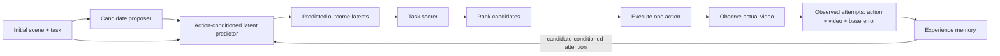

> **無效結果註記（2026-10-16）**：本文件中使用「固定舊 base predictor＋scorer 預篩候選池」的實驗結果，以及依賴這些結果的方法比較、超參數選擇與成效結論，已依使用者指示撤回，不得用於 milestone 或後續方法結論。包含共用這些候選池的 base、Q0、memory、AdaJEPA、initial-scene 與 oracle 評估，以及 2026-10-16 的 deploy-pool 重跑。原始數據保留供追查；不代表數值遭捏造。獨立的訓練紀錄、工程正確性檢查與候選覆蓋率稽核不因此被判定錯誤。權威註記：`results/INVALID_RESULTS_20261016.json`。

# 從執行回饋到候選動作排序：PHYRE proposal 的整體 framing

日期：2026-09-19。依據：重新讀取 `../Proposal.pptx` 全部 11 張投影片的文字，檢視方法與實驗圖，並整合本專案的 literature survey 與 AdaJEPA 比較。本文是研究設計建議，尚無模型訓練或比較結果；架構選項不代表已經實作或由使用者定案。

**研究定位更新：** 使用者進一步明確指出，核心是 previous attempts 的資訊內容、哪些 attempts 能取得有用 evidence，而非單純以 recurrent 取代 parameter adaptation。請以 [INFORMATION_FRAMING.md](INFORMATION_FRAMING.md) 的研究問題與 AdaJEPA 定位為準；本文後續的架構、ranking 診斷與訓練設計保留作方法選項，不代表主要貢獻一定是更高的 planning success。

## 1. 研究主題與一句話定位

建議標題：

**From Execution Feedback to Action Ranking: Experience-Conditioned Latent World Models for Physical Problem Solving**

中文：**從執行回饋到動作排序：以經驗條件化的潛在世界模型進行物理解題。**

一句話問題：

> 同一物理場景中，少量已執行 actions 的影片與預測誤差，能否改善未試 actions 的結果預測，並轉化成更好的候選動作排序與更少的解題嘗試？

英文 problem statement：

> We study whether execution feedback from previous attempts in the same physical scene can improve latent predictions for untried actions, and under what conditions these changes improve candidate ranking and task success. We investigate experience-conditioned adaptation with fixed model weights at deployment, separating predictive accuracy, decision quality, and the cost of retaining experience.

這保留 slide 2 原有的兩段問題，而不預設「更準的 latent 一定帶來更好的 decision」。主要研究對象仍是 JEPA-style action-conditioned world model。Recurrent memory 是待比較的經驗表示方法；scorer-only adaptation 是釐清預測路徑是否必要的直接比較項。

## 2. 原 proposal 保留什麼、補強什麼

| 原 slide | 保留的研究內容 | 本次補強 |
|---|---|---|
| 2 Problem | Same scene、different action；prediction 與 decision 的關係 | 將兩個效果拆開驗證，不用 latent MSE 代替 decision 指標 |
| 3 Motivation | 失敗影片可能揭露碰撞、支撐、運動資訊 | 納入成功與失敗 evidence；有用性取決於與未試 actions 的關聯 |
| 4 Visual encoder | JEPA 表示學習 | 確認表示是否保留 task success 訊息，主比較固定 encoder |
| 5 Predictor / MPC | Action-conditioned imagined outcomes 與候選評估 | 明畫 proposer、scorer、ranking；區分影片時間與跨 attempts 記憶 |
| 6 AdaJEPA | Deployment-time world-model adaptation | 列直接 baseline；共同動機、更新機制、證據預算分開比較 |
| 7 Recurrent model | 過去執行 feedback 影響下一輪預測 | 改為 experience-conditioned predictor；bank 與 recurrent 是可替換 memory |
| 8 Paired training | 同場景抽 2–5 actions | 明確分 support context 與 held-out query，query 結果只作 loss |
| 9 PHYRE | Reset-based physical interventions | simulator reset 不清除場景記憶；所有真實 trials 計入互動 budget |
| 10 Splits | Within / cross generalization | 先分 scene/template 再抽 actions，避免同場景洩漏 |
| 11 Oracle classifier | 用真實 outcome latents 檢查可判讀性 | 改名 ground-truth-outcome probe；增加 prediction、ranking、success 的分層診斷 |

## 3. 問題設定

令 x 為初始場景，g 為該 task 的成功條件，a 為有效的 intervention（例如放置物體的參數），V(x,a) 為執行後的影片，y(x,a) 為 simulator 的 task outcome。g 不必是目標圖片；依 PHYRE task 定義提供必要的目標／物體識別資訊。

第 k 輪以前已知的經驗為 Cₖ = {(aᵢ,Vᵢ)}。模型不會得到尚未執行 candidate 的真實影片或 y。World-model predictor 預測 outcome latents，不直接輸出 action；proposer 提供候選，scorer 決定排序。

\[
\mathcal A_k=\operatorname{Propose}(x,g),\qquad
\hat Z_{k,a}=P_\theta(E(x),a,\mathcal M_k),
\]

\[
s_{k,a}=G_\omega(\hat Z_{k,a},x,g),\qquad
a_k=\arg\max_{a\in\mathcal A_k}s_{k,a}.
\]

第一階段使用各方法共用的固定 candidate pool 或固定 proposer；後續可學 proposer，但它不是本研究第一個要識別的效果。不同 candidates 共享同一輪的 memory，只有執行真實 action、取得新 feedback 後才更新經驗。

這是 model-based propose–simulate–rank–execute 的 trial-level loop。在 PHYRE 每次 reset 後重新施加 intervention，不應直接套用機器人每個時間步都施加控制的 MPC 定義，也不把 placement action 當成每幀重複施加的力。[PHYRE](https://arxiv.org/abs/1908.05656)

## 4. 三個研究問題

**RQ1：哪些執行經驗能轉移到未試 actions？**

同一 query 在 no context、單次 context、多次 context 下是否改變？有接觸資訊的 experience、重複 evidence、互補 interactions 是否產生不同增益？「接觸」等分析標籤可由 simulator 離線定義作分組，不自動成為部署輸入。A→B 無效，不能直接推出 {A,C,D}→B 無效。

**RQ2：預測改善何時轉化成排序改善？**

平均 latent loss 與排名不必一致。要比較相同 candidates 的 predicted score、真實 success 和最終選擇；檢查 predictor adaptation 是否比 scorer-only feedback 更有價值，以及 decision supervision 是否比 prediction-only training 更有效。這與 value-aware model learning 的動機相關，但此處研究的是少量跨 attempts feedback 如何影響 candidates。[VAML](https://proceedings.mlr.press/v54/farahmand17a.html)

**RQ3：經驗能否被壓縮成有效的 recurrent state？**

先有能利用 context 的參考模型，才比較 fixed-size recurrence 在品質、state bytes、update latency、candidate scoring latency 上的取捨。不能以固定容量推論資訊保留最多，也不預先宣稱 recurrent 訓練最快。

RQ1–2 為最小完整研究；RQ3 為有明確成本目標的架構擴展。若課程時間有限，優先完成可解釋的比較，而不將 teacher distillation、多種 SSM 和 proposer joint training 同時放進核心範圍。

## 5. 主要架構：經驗條件化的 latent predictor

### 5.1 Evidence

固定 encoder E 與 base predictor P₀ 的第一版可使用：

\[
Z_i=E(V_i),\quad \hat Z_i^0=P_0(E(x),a_i),\quad R_i^0=Z_i-\hat Z_i^0,
\]

\[
F_i=\operatorname{Project}(a_i,Z_i,\hat Z_i^0,R_i^0;\text{space/time indices}).
\]

Projection 可放在 memory 模組內，不需要額外大型 feedback model。actual、prediction、residual 不必全部保留為冗餘 channels；需保留 action 與足夠的 outcome 關聯，並比較 residual 的學習效益。Residual 是表示方式，不增加新的觀測資訊。

先用固定 base residual，是為了讓已收集 attempts 的 evidence 可獨立計算。原 slide 7 的 adapted residual `Zᵢ−P(E(x),aᵢ,Mᵢ₋₁)` 保留為比較項，但它造成 predictor→residual→memory 的序列依賴；不能聲稱換 updater kernel 就能平行整條 pipeline。

### 5.2 Memory reference

先採 per-attempt token bank Mₖ=[F₁,…,Fₖ]。每次經驗可壓成數個時空 tokens，但要測不同壓縮量，避免把影片壓成單一 token 後就下結論「經驗無用」。Predictor 內的 scene/action features 作 queries，從 bank 讀取與該 candidate 相關的 evidence；新 cross-attention adapter 可接到預訓練 predictor，先固定主 backbone 以限制實驗變因。

這是 ANP 類 query-conditioned context reading 在本任務上的設計建議，不是論文已驗證的 PHYRE architecture。[ANP](https://arxiv.org/abs/1901.05761v2)

### 5.3 Recurrent variant

以 `Hₖ=U(Hₖ₋₁,Fₖ)` 取代 growing bank，保留相近的 query-conditioned predictor interface。每個真實 attempt 更新一次 H；不要在評分假想 candidates 時把它們當作新觀測寫進全局 memory。初期用少量 updates 的短 BPTT 即可建立對照；SMT 或 GSA 留待成本／累積問題出現後再納入。

Bank 與 recurrent 兩者都可在 inference 固定模型參數。前者沒有 learned recursive compression；後者研究如何用固定容量累積。

### 5.4 Predictor adaptation 與 scorer adaptation 的關係

| 路徑 | Memory 放在哪裡 | 可以支持的研究結論 |
|---|---|---|
| 主要方法 | Predictor；scorer 第一階段固定 | 經驗透過改變 imagined outcomes 影響 ranking |
| Scorer-only 對照 | Base predictor 固定；memory 進 evaluator | 經驗可改善模型預測的解讀，但未證明 dynamics 改善 |
| Optional combined | Predictor 與 scorer 都讀 memory | 端到端上限探索，較難歸因，放後面 |
| No-rollout 對照 | Scene/action/memory 直接評分 | 檢查 imagined rollout 是否提供額外價值 |

前一輪討論建議 scorer-only 作低風險第一個實驗；本次對齊原 slides 後，將它定位成重要比較項。方法主線保留 memory-conditioned world model，避免在未說明的情況下把原研究換成 feedback-conditioned success classifier。Scorer-only 可以工程上先完成，論文定位仍按最終證據決定。

## 6. 訓練流程與 supervision

**Stage A — 表示與評分器檢查。** 用 training scenes 的 videos 學 encoder，或使用既有預訓練 encoder；依資源選擇並記錄來源。以真實 outcome latents 訓練 task scorer，測 held-out scenes 的 success discrimination。這是 representation/readout diagnostic，不是完美 oracle，訓練 loss 低不代表 held-out query 也能判斷。

**Stage B — Base world model。** 依 slide 5 的 teacher forcing 與 rollout losses 學 action-conditioned latent prediction。這裡的 rollout 是同一 action 影片內的時間；和跨 attempts 的 memory unroll 分開命名、計算成本。確認 scorer 讀 predicted latents 的實際表現。

**Stage C — Support/query adaptation。** 在已完成 train/val/test scene/template split 後，從一個 training scene 抽不重疊的 context C 與 queries Q。2–5 actions 應明確註記是總數還是 context 數；最小版本可取總數 2–5，分成非空 context/query，另含 no-context batches。變動 context size，並固定一組 queries 比較不同 context。

對 query q 的 prediction-only 目標為：

\[
\mathcal L_{\rm pred}=\sum_{q\in Q}\ell(\hat Z_q,E(V_q)).
\]

Decision-aware 變體額外加入：

\[
\mathcal L=\lambda_{\rm pred}\mathcal L_{\rm pred}
+\lambda_{\rm dec}\mathcal L_{\rm decision}(G(\hat Z_q,x,g),y_q).
\]

可先使用 success BCE，再視資料用成功／失敗 candidate pair 的 ranking loss；binary labels 不支持強迫兩個同為失敗 candidates 之間有任意真實排序。Training 可採平衡採樣，但 evaluation 保留實際 candidate 分布，分開報告正例稀缺與 pool coverage。固定 scorer 仍可對其輸入反向傳遞梯度，不代表更新 scorer 的參數。

比較 prediction-only 與 prediction+decision 兩個設定；保留 latent fidelity 與真實 rollout 評估，避免 predictor 只學出能提高 scorer 分數的表示。Q 的真實結果只能用於 loss，不可編進 memory。沒有支持 context，就不應把單純多輸出訓練叫作 adaptation。

**Stage D — 推論與閉環評估。** 以未見 scene 開始，所有 learned weights 固定；選 candidate、執行、觀察、更新 memory，重置 simulator 後再選。換 scene 才 reset memory。Proposer 的學習及共同訓練放在驗證固定-pool效果之後。

## 7. 能辨識原因的實驗設計

### 7.1 分開四個瓶頸

1. **Candidate coverage：** 實際 pool 中是否存在成功 action？利用離線真實 labels 計算 best-in-pool success 上限。
2. **Representation/readout：** 用真實影片 latents 評分與選擇，檢查 scorer 是否能找到成功候選。它不是 oracle。
3. **World-model gap：** 相同 scorer 改讀 base predicted latents，檢查成功率落差；落差可能包含 scorer 對 predicted features 的分布失配，不全等於純 dynamics error。
4. **Adaptation effect：** 換成有 context 的 predicted latents，在同一 pool 下比較排名與選擇。

上述真實 labels／影片在離線評估才可見，不能讓方法在 test-time ranking 時讀取未執行結果。改動 proposer 會影響 coverage，改 scorer 會影響 readout；第一輪各自固定。

### 7.2 最小比較與後續擴展

| 層級 | 方法 | 要回答什麼 |
|---|---|---|
| 核心 | Frozen WM + scorer | 無 adaptation 的起點 |
| 核心 | AdaJEPA-style TTA | 已有參數更新方法是否已足夠 |
| 核心 | Context-conditioned WM，prediction-only | 跨 action 預測改善是否轉成 ranking 改善 |
| 核心 | 同架構，prediction + decision objective | supervision 對齊是否重要 |
| 診斷 | Scorer-only adaptation | 是否不必修正 imagined outcomes |
| 診斷 | No-rollout feedback scorer | World-model rollout 是否提供額外價值 |
| Memory 擴展 | Latest-only / sum-summary / recurrent | 增益是否來自累積，壓縮的成本如何 |

不需要先跑每一種 encoder × updater × scorer × loss 的完整笛卡兒積。先辨識主路徑是否有效，再在該路徑比較 memory。若 scorer-only 已同樣有效，應據此收斂貢獻，不能繼續宣稱必須改進 world-model prediction。

### 7.3 Metrics 與 split

- **主要：** 同 pool top-1 真實 success、成功 candidate 的排名、success vs total attempts；依標準 PHYRE protocol 時報 AUCCESS。
- **診斷：** held-out latent prediction loss、true-outcome scorer performance、candidate coverage，以及可取得的碰撞／接觸事件誤差。不同 encoder 空間的 raw MSE 不直接互比。
- **成本：** evidence encoding、memory update、每批 candidate scoring latency、state bytes、peak VRAM、總訓練成本；teacher/cache 若使用則計入。
- **統計：** scene-level paired comparison 與多 seeds；不要把同一 scene 的大量 actions 當作獨立 scenes。
- **Within-template：** 在已見 task templates 的未見 instances 上測試；**cross-template：** 在未見 templates 上測試。Slide 10 的 16:4:5 不應脫離具體 split 定義使用；以實際 benchmark split／fold 記錄為準。
- **Feedback budget：** 用於建立 memory 的真實 attempts 也計入總 budget。離線固定 support 評估只能證明在給定 evidence 下的適應，不能當成免費取得 feedback 的閉環成功率。

### 7.4 AdaJEPA 公平移植

同場景全部 attempts 是一個 adaptation episode；simulator reset 不重設適應後的參數，換 scene 才 reset。AdaJEPA 得到相同 videos／attempt budget，並在 validation scenes 調 learning rate、replay、更新步數。至少比較 predictor-only 與可行的 encoder+predictor 版本。跨 reset 的影片不能拼成連續 transitions。它同樣可泛化到未試 actions，不能用設定差異排除它。[AdaJEPA 原文](https://arxiv.org/abs/2606.32026v1)、[詳細比較](literature-survey/ADAJEPA_COMPARISON.md)

## 8. 預期貢獻與結果解讀

可以在 proposal 中承諾研究：

1. 一個將 same-scene feedback、未試 action 的結果預測與候選排序連結起來的評估流程，能區分各環節瓶頸。
2. 一個以 support/query episodes 學習的 experience-conditioned latent world model，部署時以新增 evidence 改變行為、固定 learned parameters。
3. 對 evidence relevance、prediction–decision alignment、memory compression 的實證分析；第三項按 project 時間決定廣度。

以上都是預期產出，不宣稱「首個」或已經優於 AdaJEPA。Outcome interpretation：

| 觀察結果 | 可以支持的結論 |
|---|---|
| Prediction 與 ranking 都改善 | 經驗改善預測，且在此 protocol 下具有決策價值 |
| Prediction 改善，ranking 沒變 | 存在 prediction–decision gap；尚無解題收益證據 |
| Scorer-only 改善、predictor route 無增益 | 本設定的主要收益可能是解讀／校正評分 |
| No-rollout 一樣好 | 尚無 evidence 支持此設定需要 imagined rollouts |
| Bank 有效、recurrent 無效 | 有用 evidence 存在，當前壓縮／更新訓練不足 |
| AdaJEPA 一樣好且成本合適 | 固定權重方法未建立實際優勢 |
| 所有 feedback 方法皆無效 | 在已測資料、表示與模型下未找到效益；不證明所有多經驗方法不可能 |

## 9. Related-work 定位

- **JEPA / action-conditioned WM：** 提供影片表示與 imagined latent trajectories。架構背景不是本研究單獨的貢獻。
- **AdaJEPA：** 共同目標為從執行結果改善預測與規劃；主要差異是參數更新與離線學得的 context/state conditioning。Both prediction and decision gains must be measured。
- **ANP / context-conditioned prediction：** 為 query 讀取相關經驗的機制依據，需承認此通用思想已有文獻。
- **Value-aware model learning：** 支持分開評估 prediction accuracy 與 decision utility，並提供 decision supervision 的動機；不代表本方法有理論最優保證。
- **Recurrent meta-learning / memory：** 支持將 adaptation state 存於 activations；本研究仍須驗證跨 actions 的物理 evidence 與 decision benefit。[RL²](https://arxiv.org/abs/1611.02779)、[SMT](https://arxiv.org/abs/2606.06479v2)

簡短英文 positioning：

> AdaJEPA adapts latent world models during MPC through test-time gradient updates. We investigate a complementary approach that learns to condition predictions on execution feedback while keeping model weights fixed during deployment. Our setting emphasizes transfer across reset-based interventions in the same scene. Crucially, we evaluate latent prediction and candidate ranking separately, and compare predictor adaptation with scorer-only adaptation to determine when correcting imagined outcomes contributes to better decisions.

## 10. 可直接用的英文 abstract

> Physical problem solving often involves multiple attempts in the same scene. Each execution provides observations that may reveal errors in an agent's predictions, but it is unclear which information transfers to untried actions and whether improved predictions lead to better decisions. We propose to study experience-conditioned latent world models for reset-based physical interventions in PHYRE. A candidate proposer generates actions, a JEPA-style world model predicts their latent outcomes, and a task scorer ranks the candidates. The model conditions subsequent predictions on observations and prediction errors from previous attempts, with learned parameters fixed during deployment. We train adaptation using same-scene support–query episodes and compare prediction-only supervision with decision-aware supervision. Our evaluation separates candidate coverage, task readability from observed latents, prediction error, and action-ranking quality. We compare against frozen models, AdaJEPA-style parameter adaptation, and scorer-only conditioning, then investigate whether useful experience can be compressed into recurrent memory. The study aims to identify when execution feedback improves physical decisions and what trade-offs arise between predictive fidelity, memory capacity, and adaptation cost.

## 11. 建議的 11 張 slide 故事線

每張以下列英文內容為主；原始大量 V-JEPA2 diagrams 可移到 backup，只保留本方法需要的介面。這是 slide-ready 文案，不代表已修改原 PPTX。

### Slide 1 — Title

**From Execution Feedback to Action Ranking**

*Experience-Conditioned Latent World Models for Physical Problem Solving*

視覺：同一場景 attempt A → feedback → candidates B/C 的不同排序。

### Slide 2 — Research Question

- Can previous attempts improve predictions for untried actions in the same scene?
- When do these changes improve action ranking and task success?
- Can useful experience be retained under a compact memory budget?

Takeaway: **Prediction gains and decision gains are separate hypotheses.**

### Slide 3 — Why Execution Feedback Might Help

- Attempts reveal outcomes of collisions, support, and object motion.
- Evidence may transfer to other actions that depend on related interactions.
- Redundant or irrelevant evidence may add little value.

視覺：一個 observed interaction，連到兩個可能相關程度不同的 candidates；標成 hypothesis，不假裝已有增益數字。

### Slide 4 — Task and Decision Pipeline

- Propose candidate actions; predict latent outcomes; score and rank.
- Execute one action, observe the result, and update experience.
- Reset the scene between attempts; retain experience within the task.

視覺：完整 proposer→predictor→scorer→rank→execute→feedback 圖。

### Slide 5 — The Prediction–Decision Gap

- Lower average latent error need not change the selected action.
- Critical contact errors can matter more than many accurate features.
- Candidate coverage and scorer quality can limit decision performance.

視覺：兩條獨立量測線，latent error 與 selected-action success；沒有實驗前不畫虛構數值。

### Slide 6 — Related Work and Positioning

- AdaJEPA: gradient-based world-model adaptation during MPC.
- Context-conditioned prediction: retrieve evidence relevant to each query.
- Value-aware learning: align model learning with downstream decisions.
- Our question: which same-scene feedback improves untried-action ranking, and through which pathway?

### Slide 7 — Experience-Conditioned Latent World Model

- Encode each observed action–outcome pair and its prediction discrepancy.
- Let candidate-conditioned predictor features read the experience memory.
- Score predicted outcomes with a task evaluator.

角落標註：**Memory bank reference; recurrent state as a compact variant.**

### Slide 8 — Learning to Use Experience

- Sample disjoint support attempts and query actions from one training scene.
- Train on held-out query outcomes; never expose query feedback as context.
- Compare latent prediction loss with prediction plus decision supervision.
- Keep learned weights fixed during test-time experience accumulation.

視覺：support A/B → memory；query C/D → predictions/scores；真實 C/D 僅接 loss。

### Slide 9 — Evaluation: Where Does Improvement Come From?

- Best-in-pool outcome: is success available among the candidates?
- Scoring observed latents: can the task evaluator recognize success?
- Scoring predicted latents: how much performance is lost through imagination?
- Adapted predictions: does feedback recover ranking and execution success?

角落標註：**Observed-outcome scorer ≠ perfect oracle.**

### Slide 10 — Baselines and Generalization

- Frozen model; AdaJEPA-style adaptation; context-conditioned predictor.
- Prediction-only vs decision-aware training; scorer-only / no-rollout diagnostics.
- Within-template and cross-template evaluation with scene-level splits.
- Shared candidate pools, matched feedback budgets, and measured runtime.

### Slide 11 — Expected Contributions and Research Stages

- Establish when same-scene execution feedback transfers to untried actions.
- Test whether predictive adaptation yields decision gains beyond score correction.
- Measure the quality–cost trade-off of compressing experience into recurrent memory.

Milestones: **Representation/readout → base planning → feedback transfer → recurrent compression.**

## 12. 最小可交付版本

固定 encoder 和候選來源；可辨識成功的 scorer；一個 base predictor；一個 attention-bank conditioned predictor；prediction-only 與 decision-aware training；frozen、AdaJEPA-style、scorer-only 的關鍵比較；同 scene 的固定-pool分析及小規模閉環驗證。Recurrent 若尚未完成，仍可以完整回答 RQ1–2，但不能將其列為已交付貢獻。

這份 framing 的成功標準是能清楚回答 feedback 是否有用、透過哪條路徑有用、成本多少。模型名稱或記憶形式應隨證據收斂。
